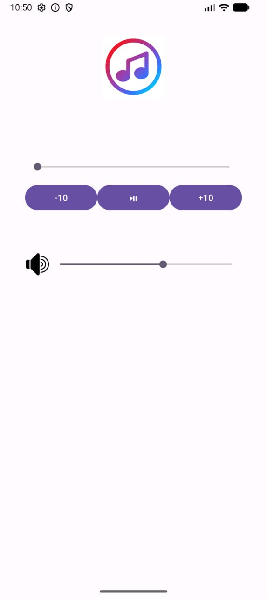

# Simple Music Player 🎵

A basic Android music player developed using Kotlin and XML as a university assignment for the **Mobile Programming 2** course.

## ✨ Features

- **Play & Pause** — Start and temporarily pause music playback.
- **Forward 10 Seconds** — Skip forward by 10 seconds.
- **Backward 10 Seconds** — Move backward by 10 seconds.
- **Playback Progress** — Display the current playback position using a `SeekBar`.
- **Seek Through Music** — Navigate to a specific position in the audio track.
- **Volume Control** — Adjust the device's music stream volume using a `SeekBar`.
- **Automatic Progress Updates** — Periodically update the playback progress using `Handler` and `Runnable`.

## Screenshots

## 🛠️ Built With

- **Kotlin** — Application logic
- **XML** — User interface layout
- **Android Studio** — Development environment
- **MediaPlayer** — Audio playback
- **SeekBar** — Playback progress and volume controls
- **Handler & Runnable** — Periodic UI updates
- **AudioManager** — System music volume control

## 📱 How It Works

The application loads an audio file from the Android `res/raw` resource directory and provides basic playback controls.

Users can play or pause the audio, skip forward or backward by 10 seconds, seek to a specific playback position, and adjust the device's music volume.

## 🚀 Getting Started

1. Clone or download this repository.
2. Open the project in Android Studio.
3. Wait for Gradle synchronization to finish.
4. Run the application on a compatible Android device or emulator.

## 🎓 Purpose

This project was created as a practical assignment for the **Mobile Programming 2** course to practice Kotlin programming, Android UI development, event handling, audio playback, and interaction with Android system services.

## 📌 Project Status

A beginner-level educational project focused on fundamental Android development concepts. It can be extended with additional features in the future.

---

**Created by [amixrzi](https://github.com/amixrzi)**
